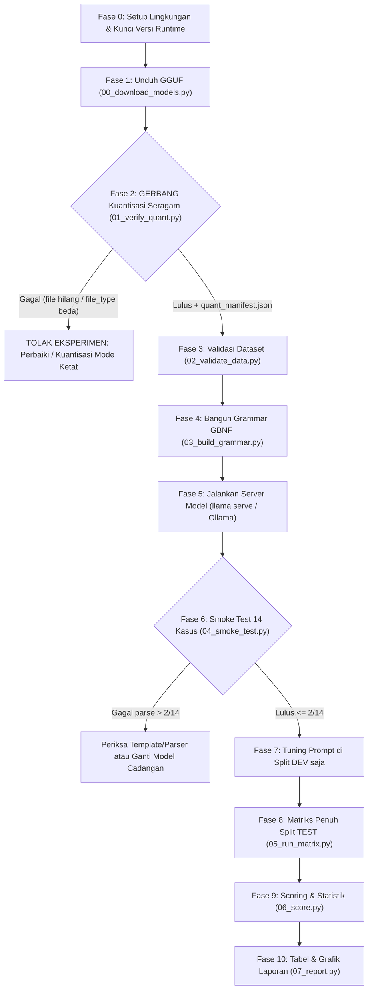
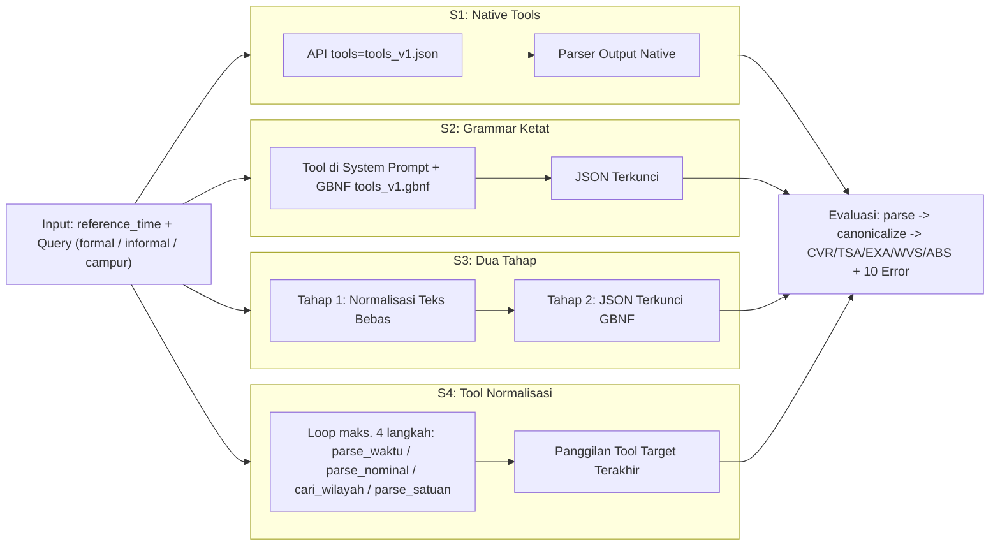

# 03. Alur Eksperimen (*End-to-End Pipeline*)

Dokumen ini menjelaskan seluruh alur kerja eksperimen **IndoArg** dari persiapan awal hingga pelaporan hasil, mencakup diagram alur, desain matriks Eksperimen A/B/C, mekanisme strategi S1–S4, aturan penguncian konfigurasi, serta jadwal & mitigasi risiko.

---

## 3.1 Diagram Alur Pipeline Utama



> **Aturan Kunci Integritas:**
> 1. `05_run_matrix.py` **secara otomatis** memanggil gerbang `01_verify_quant.py` sebelum mengirim satu pun permintaan ke model dan menolak berjalan jika kuantisasi tidak seragam.
> 2. Split **`dev`** (20%) dipakai hanya untuk iterasi prompt. Split **`test`** (80%) hanya disentuh **sekali** pada run final.
> 3. Versi `llama.cpp` dan `Ollama` **dikunci** setelah smoke test lulus sampai seluruh eksperimen selesai.

---

## 3.2 Alur Kerja Strategi S1–S4

Keempat strategi memakai system prompt dasar yang **identik** ([`configs/prompts/system_id.txt`](../configs/prompts/system_id.txt)) tanpa contoh *few-shot* agar perbandingan adil.



| Kode | Strategi | Mekanisme Teknis | Implementasi Kode |
|---|---|---|---|
| **S1** | Native Tools | Tool dikirim lewat parameter `tools` API OpenAI/Ollama; model bebas mengeluarkan tool call atau teks abstensi | [`src/indoarg/strategies/s1_native.py`](../src/indoarg/strategies/s1_native.py) |
| **S2** | Grammar Ketat | Spesifikasi 10 tool disisipkan ke system prompt; decoding dipaksa mengikuti [`grammars/tools_v1.gbnf`](../grammars/tools_v1.gbnf) (`{"name": ..., "arguments": ...}` termasuk `"no_call"`) | [`src/indoarg/strategies/s2_grammar.py`](../src/indoarg/strategies/s2_grammar.py) |
| **S3** | Dua Tahap | Tahap 1 bebas ([`s3_stage1_id.txt`](../configs/prompts/s3_stage1_id.txt)): model menuliskan hasil normalisasi argumen; Tahap 2 ([`s3_stage2_id.txt`](../configs/prompts/s3_stage2_id.txt)) dikunci GBNF memakai hasil Tahap 1 di konteks | [`src/indoarg/strategies/s3_two_stage.py`](../src/indoarg/strategies/s3_two_stage.py) |
| **S4** | Tool Normalisasi | Model diberi 4 tool normalisasi deterministik + 10 tool target (maks. 4 langkah bantu); skor dihitung pada panggilan tool target terakhir | [`src/indoarg/strategies/s4_normalizer_tool.py`](../src/indoarg/strategies/s4_normalizer_tool.py) |

---

## 3.3 Matriks Eksperimen A, B, dan C

### Eksperimen A — Matriks Utama (RQ1, RQ2, RQ3)
- **Konfigurasi:** [`configs/experiment_A.yaml`](../configs/experiment_A.yaml)
- **Kuantisasi seragam:** `Q4_K_M` untuk semua model
- **Panel model:** `M1`, `M2`, `M3`, `M4`, `M5` (5 model)
- **Strategi:** `S1`, `S2`, `S3`, `S4` (4 strategi)
- **Runtime:** `llamacpp_server` (`llama serve --jinja`)
- **Dataset:** Split `test` × 3 register (`formal`, `informal`, `campur`)
- **Skala generasi greedy (pada 220 pair / 176 pair test = 528 item):**
  $5 \text{ model} \times 4 \text{ strategi} \times 528 \text{ item} = 10.560 \text{ evaluasi}$ (belum termasuk sub-langkah S3/S4).
- **Sub-run opsional (*robustness*):** sub-sampel 100 pair dengan $T = 0{,}7$, $\text{top\_p} = 0{,}95$, `seeds = [11, 22, 33]`.

### Eksperimen B — Kuantisasi × Register (RQ4)
- **Konfigurasi:** [`configs/experiment_B.yaml`](../configs/experiment_B.yaml)
- **Tangga kuantisasi seragam:** `BF16 → Q8_0 → Q6_K → Q4_K_M → Q3_K_M` (5 tingkat, gerbang §5 dijalankan per tingkat)
- **Model:** `M1` (Qwen3.5-4B) dan `M3` (Gemma 4 E4B-it) — dua keluarga arsitektur berbeda yang masih terjangkau hingga `BF16`
- **Strategi:** `S1` + strategi terbaik dari Eksperimen A (`BEST_FROM_A`)
- **Analisis khusus:** *baseline floor check* ($\text{EXA}_{\text{BF16}} \ge 20\%$), kurva EXA vs bit per register, dan model GEE Binomial `EXA ~ C(register) * quant_bits` terklaster `pair_id`.

### Eksperimen C — Varians Runtime (RQ5)
- **Konfigurasi:** [`configs/experiment_C.yaml`](../configs/experiment_C.yaml)
- **Kuantisasi seragam:** `Q4_K_M`
- **Model:** `M1` (Qwen3.5-4B) dan `M5` (Apertus-SEA-LION-v4-8B-IT) — berbeda keluarga & template
- **Runtime yang dibandingkan (file GGUF lokal IDENTIK, SHA-256 sama):**
  1. `ollama_native`: dibuat dari [`models/modelfiles/M1.Modelfile`](../models/modelfiles/M1.Modelfile) dan [`M5.Modelfile`](../models/modelfiles/M5.Modelfile) yang menunjuk langsung ke `../Q4_K_M/M*.gguf` (bukan `ollama pull` terpisah!)
  2. `llamacpp_jinja`: `llama serve --jinja` (parser tool bawaan)
  3. `llamacpp_grammar`: `llama serve` + grammar GBNF (`S2`)

---

## 3.4 Mode Ketat Kuantisasi Mandiri (Opsional Publikasi, §5.3)

Untuk menghilangkan variabel pengganggu perbedaan quantizer antara `bartowski` (M1–M4) dan `AI Singapore` (M5), seluruh model dapat dikuantisasi sendiri dari `BF16` memakai build `llama.cpp` dan file kalibrasi `imatrix` campuran Indonesia + Inggris (~200k token di `data/calib/calib_id_en.txt`) yang identik:

```bash
# 1) Bangun importance matrix dari teks kalibrasi ID+EN
llama-imatrix -m models/BF16/M1.gguf -f data/calib/calib_id_en.txt -o models/imatrix/M1.dat

# 2) Kuantisasi ke seluruh tingkat tangga memakai imatrix yang sama
for Q in Q8_0 Q6_K Q4_K_M Q3_K_M; do
  llama quantize --imatrix models/imatrix/M1.dat models/BF16/M1.gguf models/$Q/M1.gguf $Q
done
```

---

## 3.5 Parameter Inferensi Terkunci (`configs/inference.yaml`)

| Parameter | Nilai Main Run (Greedy) | Nilai Sub-run Robustness | Keterangan |
|---|---|---|---|
| `temperature` | `0.0` | `0.7` | Deterministik (1 run cukup; ketidakpastian lewat bootstrap per `pair_id`) |
| `top_p` | `1.0` | `0.95` | Tidak memotong distribusi pada greedy |
| `top_k` | `0` | `0` | Nonaktif |
| `min_p` | `0.0` | `0.0` | Nonaktif |
| `repeat_penalty` | `1.0` | `1.0` | Tidak mengubah logit token berulang |
| `max_tokens` | `512` | `512` | Perbesar bila model memaksa *thinking* dan tandai `thinking_forced=true` |
| `n_ctx` | `8192` | `8192` | Konteks seragam lintas model & runtime |
| `thinking` | `off` | `off` | `chat_template_kwargs.enable_thinking=false` (llama.cpp) / `think=false` (Ollama) |
| `batch_concurrency` | `1` | `1` | `--parallel 1` agar pengukuran latensi & VRAM bersih |

---

## 3.6 Format Log Hasil & Manifest Reprodusibilitas

1. **Log mentah per item (`results/raw/<run_id>.jsonl`):** mencatat `run_id`, `experiment`, `model_id`, `gguf_sha256`, `quant`, `runtime`, `runtime_version`, `strategy`, `pair_id`, `register`, `prompt_hash`, `request`, `raw_output`, `steps[]`, `parsed_call`, `latency_ms`, `prompt_tokens`, `completion_tokens`, `tokens_per_s_decode`, `vram_peak_mb`, `thinking_forced`, `error`, dan `timestamp`.
2. **Log terskor (`results/scored/<run_id>.jsonl`):** menambahkan `cvr`, `tsa`, `exa`, `wvs`, `abs`, `error_codes[]`, dan `value_correct{}`.
3. **Ringkasan & statistik (`results/scored/<exp>_summary.json`):** agregasi metrik, CI bootstrap 95% (`EXA` & $\Delta\text{Reg}$), serta uji McNemar + Holm.
4. **Manifest per run (`logs/manifest_<run_id>.json`):** menyimpan SHA-256 semua GGUF, versi `llama.cpp` & `Ollama`, spesifikasi GPU/driver/RAM, hash `inference.yaml` & prompt, serta commit Git workspace.

### 6 Keluaran Tabel & Grafik Wajib Laporan (§12.3)

1. **Tabel utama:** model × strategi → EXA (CI 95%), CVR, TSA, WVS, ABS, efisiensi.
2. **Heatmap:** model × kategori nilai → $\text{VA}[k]$.
3. **Grafik batang berpasangan:** EXA formal / informal / campur per model ($\Delta\text{Reg}$).
4. **Kurva Eksperimen B:** EXA vs tingkat kuantisasi (`BF16`..`Q3_K_M`), satu garis per register.
5. **Tabel Eksperimen C:** runtime × model → EXA, CVR, latensi.
6. **Distribusi error:** proporsi 10 kode taksonomi error (§8) per strategi.

---

## 3.7 Timeline Pelaksanaan (±3 Minggu) & Mitigasi Risiko

| Minggu | Tahap | Fokus Kegiatan | Keluaran |
|---|---|---|---|
| **Minggu 1 (Hari 1–2)** | Fondasi | Setup workspace, unduh model, gerbang kuantisasi, *smoke test* 14 kasus | Panel model final lolos smoke test |
| **Minggu 1 (Hari 3–7)** | Korpus | Finalisasi gazetteer & penulisan 220 pair + verifikasi A1/A2 | `indoarg_v1.jsonl` (660 item, lolos `--strict-targets`) |
| **Minggu 2 (Hari 8–9)** | Verifikasi Pipeline | Uji integrasi S1–S4, skoring, unit test normalizer & metrik | Pipeline tervalidasi |
| **Minggu 2 (Hari 10–11)** | Tuning `dev` | Tuning prompt hanya pada split `dev`, lalu kunci `configs/` | `inference.yaml` & prompt final |
| **Minggu 2 (Hari 12–14)** | **Eksperimen A** | Jalankan 5 model × 4 strategi @ `Q4_K_M` pada split `test` | Tabel utama, heatmap, $\Delta\text{Reg}$ |
| **Minggu 3 (Hari 15–17)** | **Eksperimen B & C** | Tangga kuantisasi (M1, M3) & varians runtime (M1, M5) | Kurva kuantisasi & tabel runtime |
| **Minggu 3 (Hari 18–21)** | Analisis & Naskah | Analisis error mendalam, statistik Holm/GEE, penulisan laporan | Naskah akhir & rilis artefak |

### Matriks Risiko & Mitigasi (§17)

| Risiko | Dampak | Mitigasi Operasional |
|---|---|---|
| Parser/template Gemma 4 bermasalah di runtime | EXA jatuh bukan karena kapasitas model | Wajib lulus `04_smoke_test.py` (`<=2/14` gagal parse); pakai `llama serve --jinja`; ganti model cadangan bila gagal |
| Satu repo tidak memiliki `Q4_K_M` / tingkat tangga yang sama | Melanggar validitas komparasi kuantisasi | Kuantisasi sendiri dari BF16 (Mode Ketat §5.3) atau keluarkan model dari matriks |
| Quantizer berbeda (bartowski vs AI Singapore) | Variabel pengganggu | Mode Ketat §5.3, atau nyatakan eksplisit di bagian keterbatasan |
| VRAM 6 GB tidak cukup untuk M2/M5 atau BF16 | OOM atau latensi ekstrem | Turunkan `-ngl` / jalankan `llama fit-params` untuk offload parsial ke RAM 24 GB |
| Kebocoran tuning prompt ke split `test` | Hasil terlalu optimistis | Tuning ketat di `--split dev`; jalankan `--split test` satu kali di akhir |
| Mode *thinking* tidak bisa dimatikan pada satu model | Perbandingan token/latensi tidak setara | Naikkan `max_tokens`, catat bendera `thinking_forced=true`, bahas terpisah di laporan |
