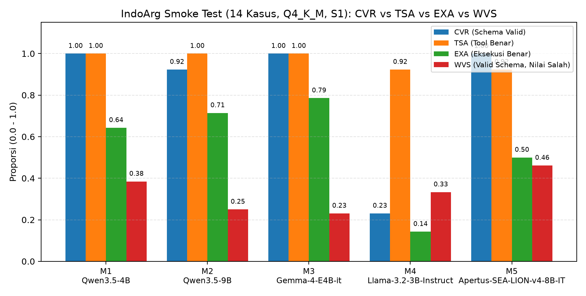
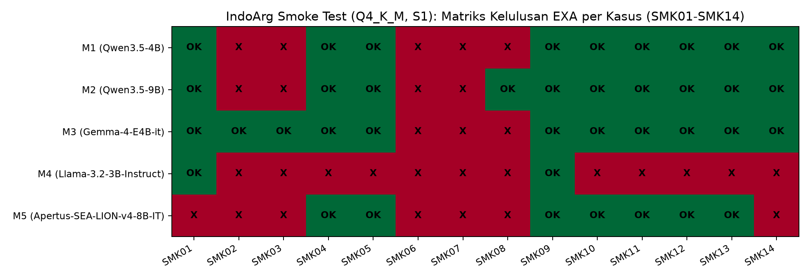
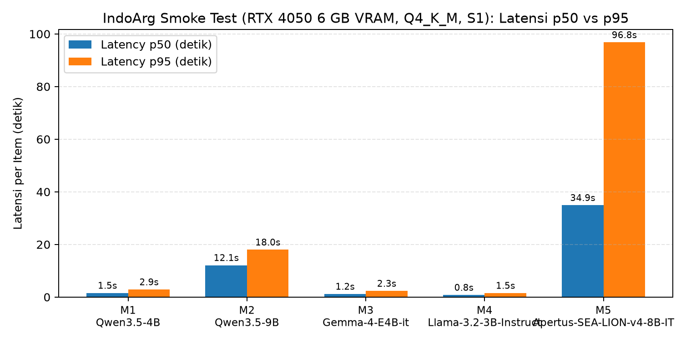

# 07. Hasil & Metrik Smoke Test Panel Model (`M1`–`M5`)

Dokumen ini merangkum seluruh metrik kuantitatif, matriks kelulusan per item, distribusi taksonomi error, latensi, serta temuan metodologis dari **Smoke Test 14 Kasus** ([`data/smoke/smoke_14.jsonl`](../data/smoke/smoke_14.jsonl)) terhadap seluruh 5 model panel IndoArg pada kuantisasi seragam **`Q4_K_M`**, strategi **`S1` (Native Tools)**, dan runtime terkunci **`llama.exe b11379`** (`commit 1537a0a8b`, `--jinja`, GPU NVIDIA RTX 4050 6 GB VRAM).

> **Status Gerbang Panel (§4 & §14):** **5 dari 5 model LULUS** (`parse_fail = 0/14` di semua model, jauh di bawah ambang batas `<= 2/14`). Tidak ada model yang perlu diganti dengan model cadangan.

---

## 7.1 Ringkasan Metrik Utama per Model

Sumber tabel CSV/Markdown: [`results/tables/smoke_S1_metrics.csv`](../results/tables/smoke_S1_metrics.csv) | [`results/tables/smoke_S1_metrics.md`](../results/tables/smoke_S1_metrics.md)

| ID | Model | Quant | Parse Gagal | CVR (Call) | TSA (Call) | EXA (All) | EXA (Call) | WVS | ABS (`no_call`) | Latensi p50 | Latensi p95 | `thinking_forced` | Status |
|---|---|---|---|---|---|---|---|---|---|---|---|---|---|
| **M3** | Gemma-4-E4B-it | `Q4_K_M` | `0/14` | **1.0000** | **1.0000** | **0.7857** | **0.7692** | **0.2308** | **1.0000** | 1,17 dtk | 2,32 dtk | `False` | **PASS** |
| **M2** | Qwen3.5-9B | `Q4_K_M` | `0/14` | 0.9231 | **1.0000** | 0.7143 | 0.6923 | 0.2500 | **1.0000** | 12,10 dtk | 17,98 dtk | `False` | **PASS** |
| **M1** | Qwen3.5-4B | `Q4_K_M` | `0/14` | **1.0000** | **1.0000** | 0.6429 | 0.6154 | 0.3846 | **1.0000** | 1,55 dtk | 2,88 dtk | `False` | **PASS** |
| **M5** | Apertus-SEA-LION-v4-8B-IT | `Q4_K_M` | `0/14` | **1.0000** | 0.9231 | 0.5000 | 0.5385 | 0.4615 | 0.0000 | 34,89 dtk | 96,79 dtk | `False` | **PASS** |
| **M4** | Llama-3.2-3B-Instruct | `Q4_K_M` | `0/14` | 0.2308 | 0.9231 | 0.1429 | 0.1538 | 0.3333 | 0.0000 | **0,79 dtk** | **1,52 dtk** | `False` | **PASS** |

---

## 7.2 Distribusi Taksonomi Error per Model

Sumber tabel: [`results/tables/smoke_S1_errors.csv`](../results/tables/smoke_S1_errors.csv)

| ID | Model | `E_PARSE` | `E_SCHEMA` | `E_TOOL` | `E_MISSING` | `E_VALUE_FORMAT` | `E_VALUE_LANG` | `E_VALUE_WRONG` | `E_HALLUC_ARG` | `E_OVERCALL` | `E_UNDERCALL` |
|---|---|---|---|---|---|---|---|---|---|---|---|
| **M1** | Qwen3.5-4B | 0 | 0 | 0 | 0 | 0 | 0 | **5** | 0 | 0 | 0 |
| **M2** | Qwen3.5-9B | 0 | 1 | 0 | 0 | 0 | 0 | **4** | 0 | 0 | 0 |
| **M3** | Gemma-4-E4B-it | 0 | 0 | 0 | 0 | 0 | 0 | **3** | 0 | 0 | 0 |
| **M4** | Llama-3.2-3B-Instruct | 0 | **10** | 1 | 0 | 2 | 2 | **7** | 0 | 1 | 0 |
| **M5** | Apertus-SEA-LION-v4-8B-IT | 0 | 0 | 1 | 0 | 0 | 0 | **5** | 0 | 1 | 0 |

---

## 7.3 Matriks Kelulusan per Kasus (`SMK01`–`SMK14`)

Sumber tabel: [`results/tables/smoke_S1_per_item_matrix.csv`](../results/tables/smoke_S1_per_item_matrix.csv)

| ID | Tool Target | Register | M1 | M2 | M3 | M4 | M5 |
|---|---|---|---|---|---|---|---|
| `SMK01` | `buat_pengingat` | informal | OK | OK | OK | OK | `E_TOOL` |
| `SMK02` | `buat_pengingat` | campur | `E_VALUE_WRONG` | `E_VALUE_WRONG` | **OK** | `E_VALUE_WRONG` | `E_VALUE_WRONG` |
| `SMK03` | `transfer_ewallet` | informal | `E_VALUE_WRONG` | `E_VALUE_WRONG` | **OK** | `E_SCHEMA,E_TOOL` | `E_VALUE_WRONG` |
| `SMK04` | `transfer_ewallet` | campur | OK | OK | OK | `E_SCHEMA,E_VALUE_FORMAT` | OK |
| `SMK05` | `cek_ongkir` | informal | OK | OK | OK | `E_SCHEMA,E_VALUE_WRONG` | OK |
| `SMK06` | `cek_ongkir` | informal | `E_VALUE_WRONG` | `E_VALUE_WRONG` | `E_VALUE_WRONG` | `E_SCHEMA,E_VALUE_WRONG` | `E_VALUE_WRONG` |
| `SMK07` | `jadwal_krl` | informal | `E_VALUE_WRONG` | `E_SCHEMA,E_VALUE_WRONG` | `E_VALUE_WRONG` | `E_SCHEMA,E_VALUE_LANG,E_VALUE_WRONG` | `E_VALUE_WRONG` |
| `SMK08` | `cek_cuaca` | informal | `E_VALUE_WRONG` | **OK** | `E_VALUE_WRONG` | `E_SCHEMA,E_VALUE_LANG` | `E_VALUE_WRONG` |
| `SMK09` | `pesan_ojek` | informal | OK | OK | OK | OK | OK |
| `SMK10` | `konversi_kurs` | formal | OK | OK | OK | `E_SCHEMA,E_VALUE_FORMAT` | OK |
| `SMK11` | `bayar_tagihan` | informal | OK | OK | OK | `E_SCHEMA,E_VALUE_WRONG` | OK |
| `SMK12` | `buat_jadwal_rapat` | campur | OK | OK | OK | `E_SCHEMA,E_VALUE_WRONG` | OK |
| `SMK13` | `cari_dokumen` | formal | OK | OK | OK | `E_SCHEMA,E_VALUE_WRONG` | OK |
| `SMK14` | `no_call` | informal | OK | OK | OK | `E_OVERCALL` | `E_OVERCALL` |

---

## 7.4 Profil Efisiensi & Latensi (RTX 4050 Laptop 6 GB VRAM)

- Model 3B–4B (`M4`, `M3`, `M1`) muat penuh atau nyaris penuh di VRAM 6 GB sehingga latensi p50 sangat cepat (**0,79–1,55 detik/item**).
- `M2` (9B, 6,17 GB) dan `M5` (8B, 5,06 GB) memerlukan *partial CPU offload* via `--fit on` pada VRAM 6 GB; `M5` lebih lambat (p50 = 34,9 dtk) karena `llama.cpp` juga menjalankan *generic tool-call grammar* untuk arsitektur `apertus`.

---

## 7.5 Temuan Awal & Perbaikan Metodologi dari Smoke Test

1. **Bukti Empiris *Wrong-Valid-Schema* (WVS):** Pada `M1`, `M3`, dan `M5`, validitas skema mencapai **100%** (`CVR = 1.0`), namun **23%–46%** panggilan valid tersebut salah secara nilai eksekusi (`E_VALUE_WRONG`) — khususnya pada idiom waktu (`lusa jam setengah 8 pagi`), slang angka Betawi (`gocap`), kode wilayah Kemendagri (`bdg`/`jogja`/`smg`), dan kode stasiun KRL (`Manggarai = MRI`).
2. **Keunggulan Awal Gemma 4 (`M3`) pada Idiom Indonesia:** `M3` menjadi satu-satunya model yang benar pada `SMK02` (`lusa` + `setengah 8 pagi` → `2026-11-25T07:30:00+07:00`) dan `SMK03` (`gocap` → `50000`).
3. **Perbaikan Kritis Pasca-Smoke Test (diterapkan sebelum tuning `dev` & run `test`):**
   - **Pembersihan *schema example leakage*:** Selama smoke test, model menyalin contoh nilai `"35.78"`, `"31.74"`, dan `"2026-11-24T19:00:00+07:00"` yang sempat tertulis di deskripsi skema; seluruh contoh literal sudah dihapus dari [`data/tools/tools_v1.json`](../data/tools/tools_v1.json) dan [`data/tools/normalizer_tools.json`](../data/tools/normalizer_tools.json).
   - **Kompatibilitas regex `llama.cpp`:** Semua escape `\d` pada pola regex skema telah diganti menjadi `[0-9]` agar konverter skema `llama.cpp` tidak mengeluarkan warning `unsupported escape: \d`.
   - **Pengaman identitas model server:** [`LlamaCppRunner.verify_loaded_model()`](../src/indoarg/runners/llamacpp_runner.py) kini otomatis memverifikasi `/props` & `/v1/models` sebelum run agar tidak mungkin terjadi tabrakan port Windows (`SO_REUSEADDR`).

## 7.6 Arsip Log Mentah Smoke Test

- [`logs/quant_manifest_A_main.json`](../logs/quant_manifest_A_main.json) (verifikasi SHA-256 & `file_type = Q4_K_M` untuk M1–M5)
- [`logs/smoke_M1_S1_20261124T1556.json`](../logs/smoke_M1_S1_20261124T1556.json)
- [`logs/smoke_M2_S1_20261124T1812.json`](../logs/smoke_M2_S1_20261124T1812.json)
- [`logs/smoke_M3_S1_20261124T1737.json`](../logs/smoke_M3_S1_20261124T1737.json)
- [`logs/smoke_M4_S1_20261124T1745.json`](../logs/smoke_M4_S1_20261124T1745.json)
- [`logs/smoke_M5_S1_20261124T1759.json`](../logs/smoke_M5_S1_20261124T1759.json)
